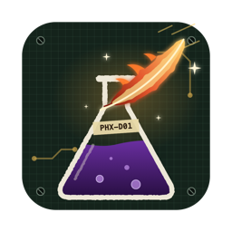

# PHX-D01

Audition LXR kits (`.SND`) on the Mac with the LXR's own sound engine, compiled natively. No SD-card swapping.

**Platform:** macOS only (Apple Silicon).

- **The real engine.** The open-source Erica Synths LXR-02 firmware, built for macOS. An optional second engine plays
  the original Sonic Potions LXR (from Brendan Clarke's LXR02Open).
- **Two panels, two models** The LXR-02 desktop and the LXR-Drum Eurorack module, with the hardware's menu pages,
  knobs, encoder and buttons.
- **Module mod matrix.** The module's 18 matrix slots load from its kit files. CV and accent jacks are playable sources,
  including v/o at 1 V/oct.
- **Morph.** Morph toward a target kit, from a slider, the perform knobs, or a matrix slot.
- **Kit banks and SD cards.** Open a folder as a bank, or load and save whole SD cards in the desktop or the module layout.
- **Samples.** User samples on the LXR-1 engine, loaded and played as LXR02Open does on the LXR-02.
- **Projects.** Kits, patterns and the card's samples in one folder. The engine, panel and unsaved edits persist between sessions.
- **Step sequencer.** 7 tracks, up to 32 steps, per-step velocity, accent and pitch, swing, and 8 pattern slots.
- **MIDI in and out, any audio device.** Output is a stereo mix or the 4 jacks on separate channels.
- **Command-line tools.** `phx-play` plays kits live in the terminal; `phx-render` renders a kit to WAV.

<p align="center"></p>

## Prerequisites
PHX-D01 contains no LXR code or sounds of its own. The engine and the kits come from their authors, and you download
them yourself:

- **The Erica Synths LXR-02 firmware** ([lxr-desktop-app](https://github.com/erica-synths/lxr-desktop-app), required).
  This is the source code that runs inside the LXR-02. The build compiles it for the Mac, so what you hear is the
  machine's own sound engine, not an imitation.
- **Brendan Clarke's LXR02Open** ([LXR02Open](https://github.com/brendanclarke/LXR02Open), optional).
  An open port of the original Sonic Potions LXR firmware. It adds a second engine, so you can hear how a kit sounds
  on the ported first-generation LXR to LXR-2 hardware.
- **Kits** (optional; the app starts with a single INIT kit). The Erica Synths factory kits are on the
  [LXR-02 page](https://www.ericasynths.lv/shop/drum-machines/drum-synthesizer-lxr-02) under Downloads:
  *Factory SD content* is the kits the machine ships with, and *Sound Pack 1 (Hrtl DLC)* is a kit pack by Leoš Hort.
  You can also open a copy of your own SD card.
- **macOS on Apple Silicon** with the Xcode command-line tools (`xcode-select --install`). Other platforms are not supported.

## Quick start
```sh
git clone https://github.com/erica-synths/lxr-desktop-app ~/code/vendor/lxr-02/lxr-desktop-app
git clone https://github.com/brendanclarke/LXR02Open ~/code/vendor/lxr-02/LXR02Open   # optional
make app && open build/PHX-D01.app
```
Then open a kit folder (File ▸ Open Kit Folder…) or a card (File ▸ Open Project…). See [Install](docs/install.md).

## Docs
- [Install](docs/install.md): prerequisites, building, getting kits
- [Panels](docs/panel.md): the desktop and module controls
- [Kits, cards and projects](docs/kits.md): banks, SD-card layouts, projects, samples
- [Module](docs/module.md): mod matrix, CV and accents, perform mode, how the module differs from the desktop
- [Internals](docs/internals.md): how the firmware runs on a Mac, the engines, the kit format

## Credits
- **Julian Schmidt / Sonic Potions**: the LXR drum synth and its firmware.
- **Erica Synths**: the LXR-02 and LXR-Drum, and the open-source
  [lxr-desktop-app](https://github.com/erica-synths/lxr-desktop-app) firmware.
- **Brendan Clarke**: [LXR02Open](https://github.com/brendanclarke/LXR02Open), the source of the LXR-1 engine.
- **Leoš Hort**: the Hrtl kit pack.

## Licence
GPL-3.0-only (see `LICENSE`). The Erica Synths firmware terms ([NOTICE](https://github.com/erica-synths/lxr-desktop-app/blob/main/NOTICE.md))
apply to their code.

PHX-D01 is an independent project and is neither affiliated with, nor endorsed by Erica Synths or
Sonic Potions. Erica Synths, LXR and LXR-02 are trademarks of Erica Synths.

The LXR-1 engine is built from your own clone of LXR02Open, under that project's non-commercial licence.
